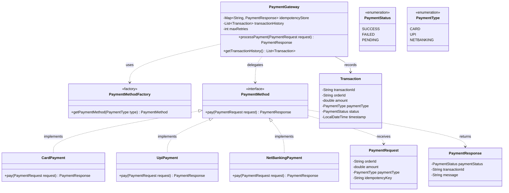
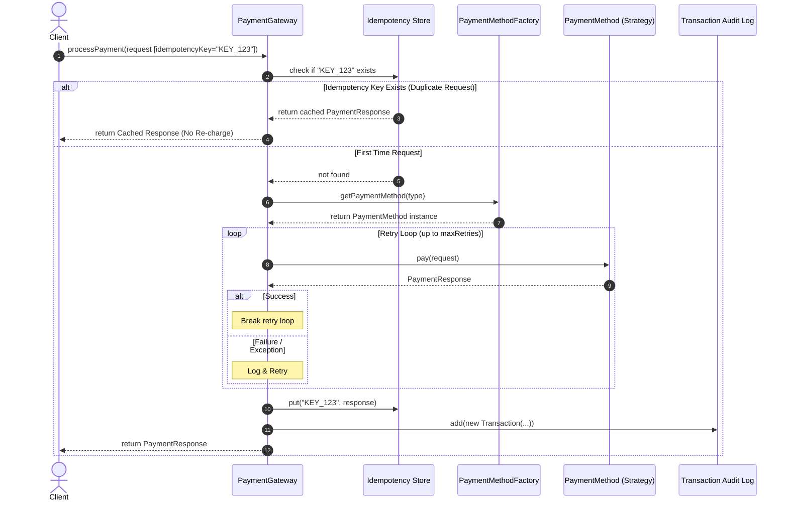

# Payment Gateway - Low Level Design (LLD)

A robust, thread-safe, and extensible Low-Level System Design for an enterprise Payment Gateway (similar to Stripe, Razorpay, or PayPal) implemented in Java.

---

## 1. System Requirements

### Functional Requirements
- **Multiple Payment Methods**: Supports Credit/Debit Cards, UPI, and NetBanking.
- **Dynamic Method Resolution**: Resolves appropriate payment processor dynamically via Factory and Strategy patterns.
- **Idempotency**: Prevents double-charging users if a network timeout causes a retry or if a user double-clicks the pay button.
- **Automatic Retries**: If a transient network glitch occurs, automatically retries the payment up to a maximum number of attempts before failing.
- **Transaction History / Audit Log**: Records every successful payment with timestamps and transaction IDs.

### Non-Functional Requirements
- **Thread Safety**: Multiple parallel payment requests must not corrupt state or cause race conditions (`ConcurrentHashMap` for idempotency cache and thread-safe collections).
- **Loose Coupling (Open/Closed Principle)**: Adding new payment methods (e.g., PayPal, Crypto, Wallets) requires zero changes to core gateway code.
- **Reliability & Consistency**: Exactly-once processing semantics backed by idempotency keys.

---

## 2. UML Diagrams

### A. Class Diagram


---

### B. Sequence Diagram (Payment & Idempotency Flow)


---

## 3. Important Concepts in Detail

### A. Idempotency (Why & How)
* **The Problem**: In distributed payment systems, a client might send a payment request, but due to a dropped connection, never receive the response. If the client retries naively, the customer will be **charged twice**!
* **The Solution**: 
  - Every payment request carries a unique `idempotencyKey` (generated by the client, e.g., a UUID or order ID).
  - Before executing the payment, `PaymentGateway` checks its `idempotencyStore` (`ConcurrentHashMap<String, PaymentResponse>`).
  - If the key exists, it **immediately returns the saved response** without hitting bank networks again.
  - If new, it executes the payment and saves the result against the key.

### B. Automatic Retries
* Payment processors interact with external bank APIs that occasionally experience transient timeouts, network blips, or 503 service unavailable errors.
* The gateway wraps processor execution in a retry loop (default 3 attempts).
* If an attempt encounters a transient error, it retries automatically. Only if all attempts fail does it return a `PaymentStatus.FAILED` response.

---

## 4. Project Structure

```
Payment-gateway_lld/
├── PaymentGatewayMain.java              # Runnable demo showing Card, UPI, NetBanking, Idempotency & Retries
├── README.md                            # Complete technical documentation
├── func-nonfunc.txt                     # Requirements specification
├── PaymentGateway.java                  # Central gateway orchestrator (idempotency, retries, transactions)
├── enums/
│   ├── PaymentStatus.java               # SUCCESS, FAILED, PENDING
│   └── PaymentType.java                 # CARD, UPI, NETBANKING
├── factory/
│   └── PaymentMethodFactory.java        # Factory instantiating strategies based on PaymentType
├── strategy/
│   ├── PaymentMethod.java               # Strategy interface: pay(PaymentRequest)
│   ├── CardPayment.java                 # Credit/Debit Card processor
│   ├── UpiPayment.java                  # UPI / VPA processor
│   └── NetBankingPayment.java           # NetBanking processor
└── transaction/
    ├── PaymentRequest.java              # Request object with amount, type & idempotencyKey
    ├── PaymentResponse.java             # Response object with status, txnId & message
    └── Transaction.java                 # Immutable ledger audit record
```

---

## 5. How to Compile & Run

From the `Payment-gateway_lld` directory:

```bash
javac -cp ".;enums;factory;strategy;transaction" *.java enums/*.java factory/*.java strategy/*.java transaction/*.java
java -cp ".;enums;factory;strategy;transaction" PaymentGatewayMain
```
