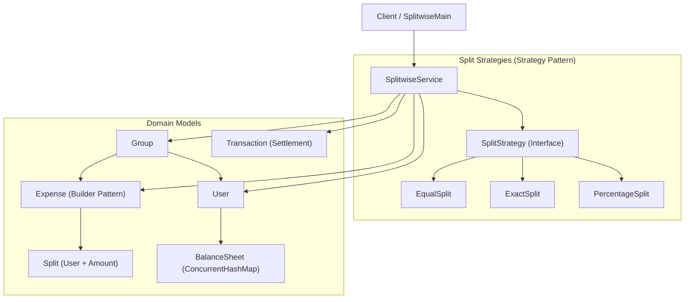
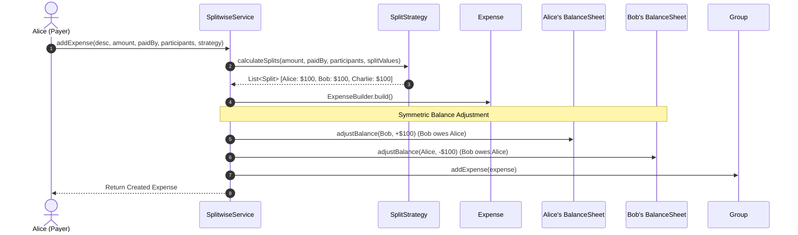

# Splitwise - Low Level System Design (LLD)

A thread-safe, extensible Low-Level System Design for an expense-sharing application (like Splitwise) implemented in Java.

---

## 1. System Requirements

### Functional Requirements
- **Users & Groups**: Create users and organize them into shared expense groups.
- **Multiple Split Strategies**:
  - **Equal Split**: Evenly splits expense among all participants.
  - **Exact Split**: Each participant pays a specified numerical amount.
  - **Percentage Split**: Each participant pays a specified percentage (validates sum = 100%).
- **Balance Sheet per User**: Each user maintains an internal balance sheet tracking who owes them money and whom they owe.
- **Debt Simplification**: Calculates the minimum number of transactions needed to settle all debts in a group.
- **Settlement & History**: Record payments to settle debts and track transaction history.

### Non-Functional Requirements
- **Thread Safety**: Concurrent expense additions and settlements must not corrupt balance sheets (`ConcurrentHashMap` + `synchronized` balance adjustments).
- **Extensibility**: Easily add new split strategies (e.g., share-based or dynamic ratio) without modifying core expense or service logic.
- **Precision**: Monetary computations accurately handled without floating-point drift.

---

## 2. Architecture & Design Patterns



### Design Patterns Used
1. **Strategy Pattern (`SplitStrategy`)**:
   - Decouples split calculation from the `Expense` model. Different algorithms (`EqualSplit`, `ExactSplit`, `PercentageSplit`) can be selected dynamically at runtime.
2. **Builder Pattern (`Expense.ExpenseBuilder`)**:
   - Provides an expressive, fluent way to construct complex `Expense` objects with validation checks before creation.
3. **Decoupled Balance Sheet**:
   - Each `User` owns an isolated `BalanceSheet` tracking mutual obligations. Expenses mutate balances symmetrically ($+amount$ for payer, $-amount$ for debtor).

---

## 3. Core Execution Flows

### A. Adding an Expense (`addExpense`)


### B. Debt Simplification Algorithm (`simplifyGroupDebts`)
Instead of performing $N(N-1)/2$ peer-to-peer transfers, the system computes the **net balance** for each group member:
1. **Creditors ($> 0$)**: Placed in a Max-Heap (ordered by largest credit).
2. **Debtors ($< 0$)**: Placed in a Min-Heap (ordered by largest debt).
3. **Greedy Matching**: Greedily matches the largest debtor with the largest creditor:
   $$\text{settledAmount} = \min(\text{debt}, \text{credit})$$
4. Continues until all debts are settled in minimal transactions.

---

## 4. Project Structure & File Guide

```
Split-wise-lld/
├── SplitwiseMain.java                # Runnable demo verifying Equal, Exact, Percentage splits & settlements
├── README.md                         # Technical documentation
├── func-nonfunc.txt                  # Requirements specification
├── model/
│   ├── BalanceSheet.java             # Thread-safe user ledger tracking mutual balances
│   ├── Expense.java                  # Expense entity constructed via Builder Pattern
│   ├── Group.java                    # Group containing members and expense history
│   ├── Split.java                    # Represents a participant's share in an expense
│   ├── Transaction.java              # Records settlement payments between two users
│   └── User.java                     # User entity with unique ID and balance sheet
├── service/
│   └── SplitwiseService.java         # Core service orchestrating expenses, balances & debt simplification
└── Strategy/
    ├── SplitStrategy.java            # Split strategy contract
    ├── EqualSplit.java               # Divides total amount equally among participants
    ├── ExactSplit.java               # Splits by specified exact amounts (validates sum == total)
    └── PercentageSplit.java          # Splits by percentages (validates sum == 100%)
```

---

## 5. How to Run

From the `Split-wise-lld` directory:

```bash
javac -cp ".;model;service;Strategy" *.java model/*.java service/*.java Strategy/*.java
java -cp ".;model;service;Strategy" SplitwiseMain
```
