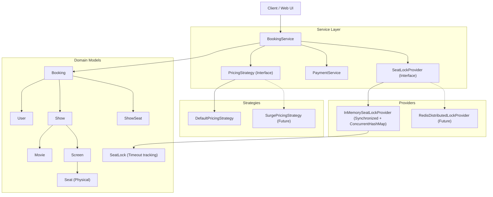
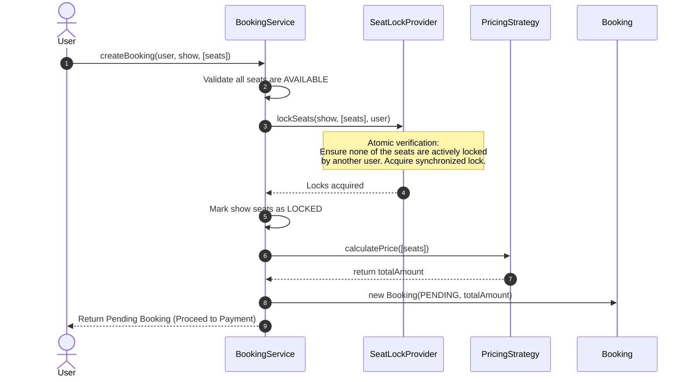
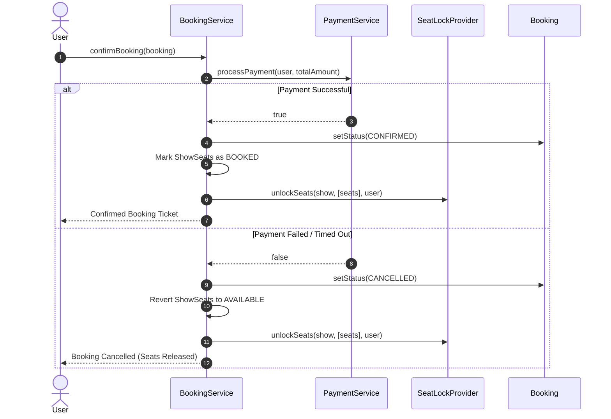

# Movie Ticket Booking System (BookMyShow) - Low Level Design

A concurrent, thread-safe, and extensible Low-Level System Design for an online Movie Ticket Booking platform (like BookMyShow / Fandango) implemented in Java.

---

## 1. System Requirements

### Functional Requirements
- **Browse & View**: Users can view cinemas, screens, movies, and shows.
- **Seat Selection**: Multiple seats can be selected across different seat tiers (`REGULAR`, `PREMIUM`, `VIP`).
- **Temporary Seat Locking**: When a user selects seats and proceeds to checkout, those seats must be temporarily locked with a timeout (e.g. 5–10 minutes) so other users cannot grab them.
- **Dynamic Pricing**: Ticket prices vary based on seat tier and dynamic pricing strategies.
- **Payment & Booking Confirmation**:
  - If payment succeeds: booking is `CONFIRMED`, seats are permanently marked `BOOKED`, and locks are released.
  - If payment fails or times out: booking is `CANCELLED`, seats revert to `AVAILABLE`, and locks are freed.

### Non-Functional Requirements
- **High Concurrency & Thread Safety**: Thousands of users competing for the same high-demand seats simultaneously must never result in double booking.
- **Atomicity**: Seat locking and confirmation must be all-or-nothing (if 1 of 3 requested seats cannot be locked, none of them are locked).
- **Loose Coupling & Extensibility**: Seat locking mechanisms (In-Memory, Redis Distributed Locks) and pricing models can be swapped without touching core booking logic.

---

## 2. Architecture & Design Patterns



### Design Patterns Used
1. **Provider / Strategy Pattern for Seat Locking (`SeatLockProvider`)**:
   - Decouples lock management from business workflows. Allows switching from in-memory synchronized locking to Redis-based distributed locking (`Redlock`) seamlessly.
2. **Strategy Pattern for Pricing (`PricingStrategy`)**:
   - Permits dynamic price calculations (day-of-week discounts, surge pricing for blockbusters, seat-tier multipliers) without modifying `BookingService`.
3. **State Pattern / Status Enums (`BookingStatus`, `SeatStatus`)**:
   - Explicit state transitions:
     - `AVAILABLE` $\rightarrow$ `LOCKED` $\rightarrow$ `BOOKED` (or reverted to `AVAILABLE`).
     - `PENDING` $\rightarrow$ `CONFIRMED` / `CANCELLED`.

---

## 3. Core Execution Flows

### A. Seat Selection & Temporary Lock (`createBooking`)


### B. Payment & Booking Confirmation (`confirmBooking`)


---

## 4. Deep Dive: Services & Providers

### A. `services/BookingService.java`
The central orchestrator of the entire booking lifecycle:
* **Dependency Injection**: Receives `SeatLockProvider`, `PaymentService`, and `PricingStrategy` via constructor.
* **Two-Phase Booking Protocol**:
  1. **Phase 1 (`createBooking`)**: Verifies seat availability, delegates atomic locking to `SeatLockProvider`, computes dynamic pricing, and returns a `PENDING` booking.
  2. **Phase 2 (`confirmBooking`)**: Executes payment. On success, transitions status to `CONFIRMED` and permanently books the seats. On failure, transitions status to `CANCELLED` and unlocks the seats.

### B. `providers/SeatLockProvider.java` & `InMemorySeatLockProvider.java`
The concurrency guard preventing race conditions and double bookings:
* **Atomic Seat Locking**:
  ```java
  public synchronized void lockSeats(Show show, List<Seat> seats, User user)
  ```
  Acquiring locks is an atomic check-then-act operation. If 2 users click on seat A1 at the same millisecond, the `synchronized` block ensures only one thread acquires the lock; the second thread receives an `IllegalStateException`.
* **Lock Expiration Mechanism**:
  - `SeatLock` stores `lockTime` and `timeoutinseconds`.
  - When checking locks via `isExpired()`, stale locks from abandoned checkout sessions are treated as expired and automatically eligible for re-locking.

---

## 5. Project Structure

```
movie-booking-sd/
├── MovieBookingMain.java                   # Runnable driver verifying end-to-end booking & lock contention
├── README.md                               # System documentation
├── func-noncfunc.txt                       # Requirements notes
├── enums/
│   ├── BookingStatus.java                  # PENDING, CONFIRMED, CANCELLED, EXPIRED
│   ├── SeatStatus.java                     # AVAILABLE, LOCKED, BOOKED
│   └── SeatType.java                       # REGULAR, PREMIUM, VIP
├── models/
│   ├── Booking.java                        # Booking aggregate entity
│   ├── Cinema.java                         # Cinema complex with screens
│   ├── Movie.java                          # Movie details
│   ├── Screen.java                         # Hall containing physical seats
│   ├── Seat.java                           # Physical seat (row, column, type)
│   ├── SeatLock.java                       # Lock entity holding user and expiry
│   ├── Show.java                           # Movie screening on a specific screen
│   ├── ShowSeat.java                       # Per-show seat state (status, price)
│   └── User.java                           # User profile
├── providers/
│   ├── SeatLockProvider.java               # Lock provider interface contract
│   └── InMemorySeatLockProvider.java       # Thread-safe in-memory lock implementation
├── services/
│   ├── BookingService.java                 # Core booking workflow orchestrator
│   └── PaymentService.java                 # Payment gateway integration interface
└── Strategy/
    ├── PricingStrategy.java                # Dynamic pricing contract
    └── DefaultPricingStrategy.java         # Base sum pricing implementation
```

---

## 6. How to Run

From the `movie-booking-sd` directory:

```bash
javac -cp ".;enums;models;providers;services;Strategy" *.java enums/*.java models/*.java providers/*.java services/*.java Strategy/*.java
java -cp ".;enums;models;providers;services;Strategy" MovieBookingMain
```
