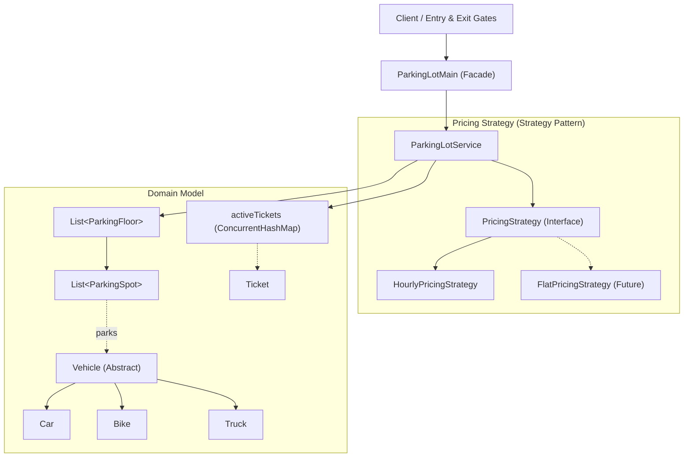
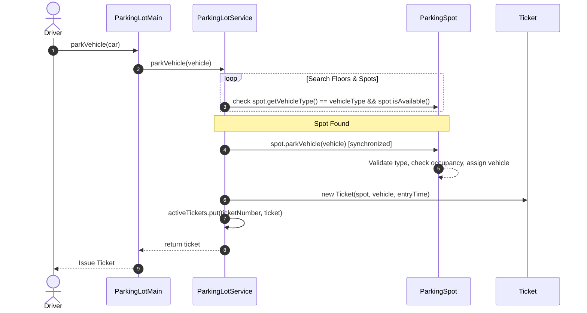
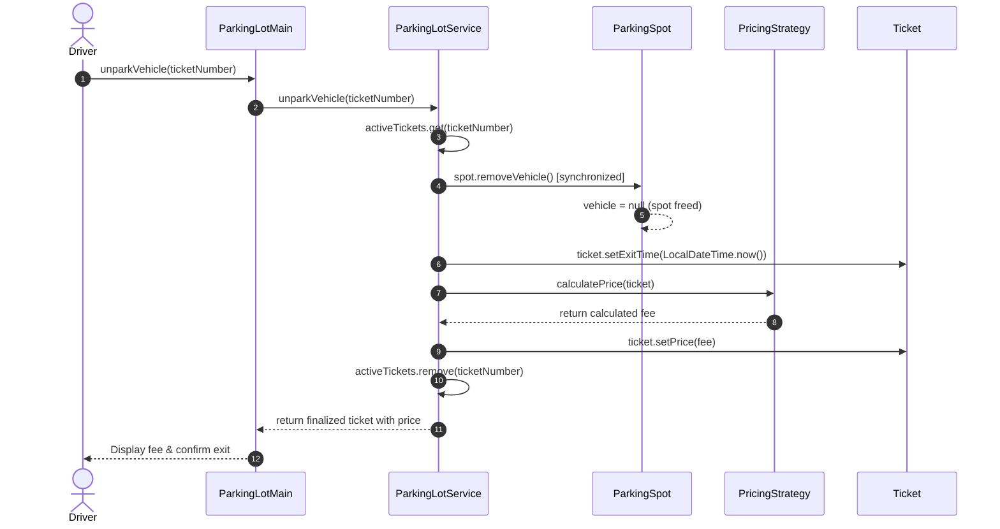

# Parking Lot - Low Level Design (LLD)

A robust, thread-safe, and extensible Low-Level System Design for an automated Multi-Floor Parking Lot System implemented in Java.

---

## 1. Requirements

### Functional Requirements
- **Multi-Floor Support**: Supports multiple parking floors, each containing multiple parking spots.
- **Multiple Vehicle Types**: Accommodates various vehicle types (Car, Bike, Truck).
- **Dedicated Spots**: Each parking spot is tailored to a specific vehicle type.
- **Vehicle Entry (Parking)**: Automatically finds the nearest available compatible spot, parks the vehicle, and generates a time-stamped ticket.
- **Vehicle Exit (Unparking)**: Validates the ticket, calculates parking fees based on duration and pricing strategy, frees the spot, and marks the ticket complete.

### Non-Functional Requirements
- **Thread-Safety & Concurrency**: Multiple vehicles entering or exiting concurrently cannot occupy the same spot or corrupt active ticket data.
- **Extensibility**: Easy to plug in new vehicle types (e.g., Electric Vehicles) or new pricing models (e.g., Flat Rate, Weekend Surge) without modifying core business logic (Open/Closed Principle).
- **Clean OOP Design**: Clear separation between domain models, pricing algorithms, and service orchestration.

---

## 2. Architecture & Design Patterns



### Design Patterns
1. **Strategy Pattern** (`PricingStrategy`, `HourlyPricingStrategy`):
   - Decouples fee calculation algorithms from `ParkingLotService`. Dynamic pricing strategies can be swapped at runtime or configured per lot.
2. **Facade Pattern** (`ParkingLotMain`):
   - Provides a clean, simplified gateway API for vehicle entry and exit operations, shielding external callers from internal floor and spot traversal.
3. **Inheritance & Polymorphism** (`Vehicle`, `Car`, `Bike`, `Truck`):
   - Extensible vehicle hierarchy where each subtype encapsulates its corresponding `VehicleType`.

---

## 3. Execution Flows

### A. Vehicle Entry Flow (`parkVehicle`)


### B. Vehicle Exit Flow (`unparkVehicle`)


---

## 4. Project Structure & File Guide

```
parking-lot-sd/
├── ParkingLotMain.java              # Facade / entry point for parking lot operations
├── func-nonfunc.txt                 # Requirements & entity specification notes
├── README.md                        # Documentation
├── domain/
│   ├── parking/
│   │   ├── ParkingFloor.java        # Holds floorId and list of parking spots
│   │   └── ParkingSpot.java         # Thread-safe slot with vehicle type check
│   ├── ticket/
│   │   └── Ticket.java              # Represents parking ticket with timestamps & fees
│   └── vehicle/
│       ├── Vehicle.java             # Abstract vehicle base class
│       ├── VehicleType.java         # Enum: CAR, BIKE, TRUCK
│       ├── Car.java                 # Concrete Car vehicle
│       ├── Bike.java                # Concrete Bike vehicle
│       └── Truck.java               # Concrete Truck vehicle
├── service/
│   └── ParkingLotService.java       # Core orchestration (spot assignment, unparking, ticket tracking)
└── strategy/
    ├── PricingStrategy.java         # Pricing strategy contract
    └── HourlyPricingStrategy.java   # Duration-based hourly pricing calculation
```

---

## 5. Concurrency & Thread-Safety

- **Granular Spot Locking**: `ParkingSpot.parkVehicle()` and `ParkingSpot.removeVehicle()` are marked `synchronized`. If multiple threads simultaneously attempt to claim the same spot, only one succeeds while the other is rejected or redirected.
- **Concurrent Ticket Registry**: `activeTickets` uses `ConcurrentHashMap<String, Ticket>` for non-blocking concurrent reads, writes, and deletions.
- **Immutability & Defensive Copying**: `ParkingFloor.getParkingSpots()` returns `List.copyOf(parkingSpots)` so outside callers cannot modify internal floor collections.
